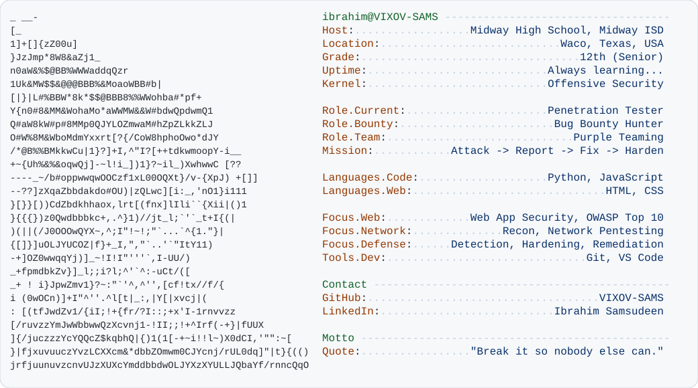

<a href="https://github.com/VIXOV-SAMS">
  <picture>
    <source media="(prefers-color-scheme: dark)" srcset="dark_mode.svg">
    
  </picture>
</a>

`ibrahim@VIXOV-SAMS:~$ cat mission.txt`

**I attack networks so they can be fixed.** Pentesting · bug bounty · purple teaming. I find the holes, report them, and help harden them.

### `~/toolbox`

  
  
  
  
  
  
  
  

### `~/github-stats`

  
  

  <code>ibrahim@VIXOV-SAMS:~$ exit</code> · thanks for stopping by

